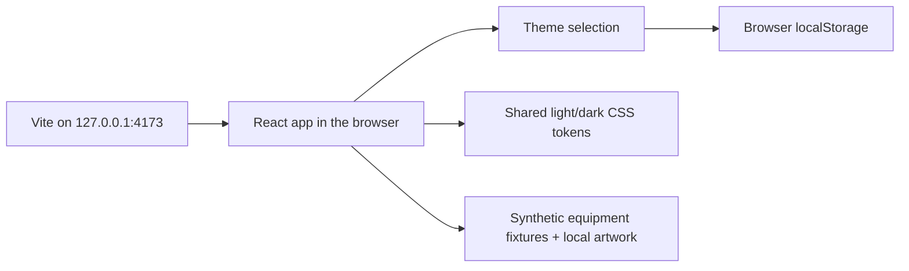

# Orbit

A local Honkai: Star Rail relic workspace for PC players. Orbit is being built to inspect an entire relic inventory, compare six-slot builds, search stat targets, and explore action-value speed tuning.

## Current status

English is the primary interface language, including scanner guidance, accessibility labels, error states, and document metadata. Familiar HSR character, relic, set, and stat names are preserved.

The React/TypeScript/Vite application follows the owner's Figma equipment design with the approved density and interaction revisions: a horizontal Acheron context, six equipment selectors, a visual relic grid, and a selected-item inspector. Both light and dark themes retain the local preference. On smaller screens, detail opens in a native dialog, with a full-height layout on mobile.

Without a saved personal inventory, the app opens with eight clearly labeled synthetic demo relics. Saved inventory restores from IndexedDB on reload. Search by name/set/main stat, filter by slot or locked/unlocked status, and sort by equipped-first or either slot direction. Equipment selection keeps the current filters; Show selected relic clears filters when the selected item is hidden. Reset filters restores the default collection/order. Exit demo opens the empty workspace; Open demo or Explore demo restores the example. Selection, filters, and sorting reset on reload; demo items are not saved as a personal inventory.

Scanner inventory import is available as the first O-04 milestone. Build comparison, optimization, and the speed timeline are not usable yet. The design is documented in [DESIGN.md](DESIGN.md) and the [Figma handoff](docs/FIGMA_HANDOFF.md). See [browser verification](docs/VERIFICATION.md) and [asset sources/notices](docs/ASSETS.md).

See the [implementation plan](docs/IMPLEMENTATION_PLAN.md) for feature acceptance criteria and the [resume checkpoint](docs/SESSION_STATE.md) for the latest verified work.

## Import your inventory

Use **Import scanner JSON or Orbit backup** to choose a Reliquary Archiver or Kel-Z HSR Scanner export (source schema 4). Check the relic count, then choose **Replace inventory**. Cancel keeps your existing collection. Validation or storage errors also leave it unchanged. Limit: 20 MiB and 10,000 relics.

Search by set, main stat, owner or scanner ID; filter slot and equipment/lock/discard status. The collection uses 48-item pages. Select an item to see active, preview and reroll substats separately. Source precision is shown: OCR cannot reveal hidden SPD decimals. Imported cards currently show set names and main-stat keys; catalogue artwork, main-stat amounts and character-name lookup remain planned in O-04b.

Use **Download backup** before clearing browser data. Re-import that file through the same picker. Inventory stays in IndexedDB in this browser profile and origin; it is not synchronized to GitHub or another device. Demo selection never replaces your saved inventory. Only supported relic fields are retained, not the scanner's account/gacha/material data. No real-account export has been tested yet.

## Requirements

- Node.js 22.12.0 or newer. Development has been verified on Node.js 24.16.0.
- npm; the package manager version is recorded in [package.json](package.json).
- Git to clone the repository.
- A modern desktop browser.

Internet access is needed to clone the repository and download dependencies. No game account credentials or environment variables are required to run the current application.

## Run locally on Windows

Open PowerShell and clone the project:

```powershell
git clone https://github.com/darelaj/orbit.git
cd orbit
npm.cmd ci
npm.cmd run dev
```

For an existing checkout, run commands from its repository root. If dependencies are already installed and unchanged, start with npm.cmd run dev; npm.cmd ci is not needed on every launch. Stop any running Orbit dev/preview/test-watch process before reinstalling dependencies. On other shells/platforms, use npm in place of npm.cmd.

Open [http://127.0.0.1:4173](http://127.0.0.1:4173). The dev server provides hot module replacement while source files change. Keep the terminal running; press Ctrl+C in that terminal to stop it.

The scripts deliberately bind to loopback and use a fixed port. If port 4173 is occupied, stop the existing Orbit dev/preview process or choose a different port explicitly. Do not terminate an unrelated process to free the port.

### Windows dependency recovery

If PowerShell reports that npm.ps1 cannot run because scripts are disabled, use npm.cmd for the commands in this README. Changing the execution policy is not required.

If npm.cmd ci fails with EPERM / unlink on a native .node file such as rolldown-binding.win32-x64-msvc.node, a running Orbit process may still have the file loaded. Stop Orbit with Ctrl+C in the terminal that launched it, including any Orbit process started by an IDE or agent. A failed clean install can leave dependencies incomplete, so a subsequent 'vite' is not recognized error does not mean Vite needs a global installation.

After stopping those processes, run from the repository root:

```powershell
npm.cmd ci
```

Wait for a successful exit before starting the app:

```powershell
npm.cmd run dev
```

As described in the [npm ci documentation](https://docs.npmjs.com/cli/v11/commands/npm-ci/), a clean install removes the existing node_modules directory before installing from the lockfile. Keep package-lock.json when recovering. If EPERM persists after Orbit has stopped, check the error's named file for another process lock or a permissions/security-software issue before retrying.

## Build and preview

Create the production build:

```powershell
npm.cmd run build
```

The build type-checks the project and writes bundled files to dist/. To inspect that build, stop the dev server first, then run:

```powershell
npm.cmd run preview
```

Open [http://127.0.0.1:4173](http://127.0.0.1:4173) again. Development and preview cannot run on that port simultaneously. Preview serves the existing dist/ build; rebuild after changes if you want an updated production preview.

## Development commands

| Command | Purpose |
| --- | --- |
| npm.cmd ci | Install the exact dependency versions from package-lock.json |
| npm.cmd run dev | Start the loopback-only Vite development server |
| npm.cmd run typecheck | Run strict TypeScript checks without emitting files |
| npm.cmd test | Run the Vitest unit/component suite once |
| npm.cmd run test:watch | Run tests in watch mode during development |
| npm.cmd run build | Type-check and build the production bundle |
| npm.cmd run preview | Serve the existing production build locally |

Use npm.cmd in Windows PowerShell when script execution policy blocks npm.ps1. After dependency changes, commit package.json and package-lock.json together. A README-only change does not require reinstalling dependencies or rebuilding the application.

## Architecture

### Implemented foundation

Orbit is a client-side React application served by Vite. React holds transient demo filters and selected-item identity; the filtered list is derived during rendering. Native dialogs provide scanner guidance and item details on smaller screens. There is no application backend, account system, or inventory database yet.



The current source layout is:

```text
orbit/
├── src/
│   ├── main.tsx              React entry point
│   └── app/
│       ├── App.tsx           Shell, demo filters/selection, native dialogs
│       ├── Equipment.tsx     Relic cards, detail, image fallback
│       ├── Workspace.tsx     Character equipment, filters, scanner guide
│       ├── demo.ts           Explicitly synthetic item fixtures and slot types
│       ├── fonts.css         Local Figma font families and weights
│       ├── theme.ts          Theme selection and preference persistence
│       ├── styles.css        Shared styles and light/dark theme tokens
│       └── App.test.tsx      Theme, filtering, selection, empty and image-error flows
├── src/domain/               Implemented scanner validation and backup format
├── src/features/inventory/   Implemented import and personal inventory view
├── src/storage/              Implemented IndexedDB inventory persistence
├── public/assets/            Game images, Figma SVGs, local fonts, source notices
├── docs/                     Product contracts, architecture, planning, checkpoints
├── .agents/skills/           Pinned project skills and HSR integrity guidance
├── AGENTS.md                 Repository operating instructions
├── DESIGN.md                 Revised HSR-inspired design brief
├── index.html                HTML entry point
├── vite.config.ts            React/Vitest configuration
├── tsconfig.json             Strict TypeScript configuration
├── package.json              Scripts and pinned dependencies
└── package-lock.json         Reproducible dependency graph
```

The theme is stored under the versioned localStorage key orbit:theme:v1. If no saved choice exists, Orbit follows the browser's system preference. Changing hostname, port, or browser profile changes the storage origin; clearing browser data removes the saved preference.

Artwork is bundled locally, with attribution and the upstream license recorded in [ASSETS.md](docs/ASSETS.md). No external font or image CDN is required at runtime.

### Planned feature architecture

Inventory validation, its React view, and IndexedDB inventory storage are implemented. Remaining responsibilities in these layers are planned:

| Layer | Responsibility |
| --- | --- |
| React feature views | Inventory filters/details, A/B loadouts, optimizer controls/results, team timeline |
| Pure TypeScript domain modules | Implemented export validation/normalization; planned stat calculations, legal-build checks, action-value math |
| Module Web Worker | Bounded optimization with progress, cancellation, and stale-result protection |
| Versioned IndexedDB records | Implemented local inventory; planned profiles, saved loadouts, and team configuration |
| Game-data catalogue | Explicitly sourced/versioned constants with visible handling of unknown records |

The implemented import flow is scanner JSON -> complete validation -> normalized inventory -> atomic local persistence -> React views. Invalid input must preserve the previous valid inventory. Search will run off the main thread so controls remain responsive.

Personal inventory is processed locally in the browser. No cloud sync or account login is planned. See [ARCHITECTURE.md](docs/ARCHITECTURE.md) for module boundaries, worker messages, persistence, and game-data requirements.

## Inventory source

The intended full-inventory inputs are JSON exports from [Reliquary Archiver](https://github.com/IceDynamix/reliquary-archiver) or [Kel-Z HSR Scanner](https://github.com/kel-z/HSR-Scanner). Extraction happens in those tools; Orbit accepts schema 4 files locally but does not scan the game.

Enka UID lookup supplies public showcase data and cannot provide every unequipped relic. OCR exports also cannot recover hidden SPD decimals, which matters for close speed thresholds. The importer preserves provenance and precision as described in [IMPORT_FORMAT.md](docs/IMPORT_FORMAT.md).

No personal inventory, game credentials, or packet captures are included in this repository.

## Documentation and contributing

Start with the [documentation map](docs/README.md). The main references are:

- [AGENTS.md](AGENTS.md): repository workflow, skills, invariants, and verification.
- [DESIGN.md](DESIGN.md): owner-selected HSR equipment inspiration and two-theme design.
- [Product scope](docs/PRODUCT.md) and [implementation plan](docs/IMPLEMENTATION_PLAN.md).
- [Architecture](docs/ARCHITECTURE.md), [import contract](docs/IMPORT_FORMAT.md), and [calculation contract](docs/CALCULATIONS.md).
- [Testing](docs/TESTING.md), [skill provenance](docs/SKILLS.md), and [resume checkpoint](docs/SESSION_STATE.md).

Use a branch per coherent task and focused commits. Integrate through a PR after the relevant checks pass, verify the merge, then delete the source branch remotely and locally. Preserve task history in the commits and PR.

Update this README in the same task when setup requirements, runnable commands, supported workflows, architecture boundaries, storage behavior, or current feature availability changes. Keep planned behavior labeled as planned and link to detailed contracts instead of duplicating them.
