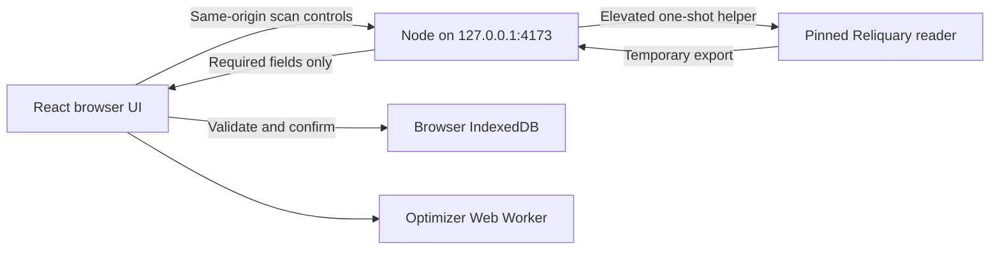

# Orbit

A local Honkai: Star Rail relic workspace for PC players. Orbit is being built to inspect an entire relic inventory, compare six-slot builds, search stat targets, and explore action-value speed tuning.

## Scope

Orbit focuses on HSR relic inventory, same-profile comparison, panel-stat optimization and fixed-speed tuning on PC. Calculations and durable data stay in the browser; only an explicit local scan uses the bounded native reader. It has no account login, cloud sync, telemetry, gacha/check-in, auto-salvage, game memory access or game automation. Cross-game support, whole-team allocation and combat/DPS rotations are outside the current build. Automatic character profiles, CV/target priorities and simpler workspaces are planned in O-11, not implemented.

## Current status

English is the primary interface language, including scanner guidance, accessibility labels, error states, and document metadata. Familiar HSR character, relic, set, and stat names are preserved.

The React/TypeScript/Vite application follows the owner's Figma equipment design with the approved density and interaction revisions: a horizontal Acheron context, six equipment selectors, a visual relic grid, and a selected-item inspector. Both light and dark themes retain the local preference. On smaller screens, detail opens in a native dialog, with a full-height layout on mobile.

Without a saved personal inventory, the app opens with eight clearly labeled synthetic demo relics. Saved inventory restores from IndexedDB on reload. Search by name/set/main stat, filter by slot or locked/unlocked status, and sort by equipped-first or either slot direction. Equipment selection keeps the current filters; Show selected relic clears filters when the selected item is hidden. Reset filters restores the default collection/order. Exit demo opens the empty workspace; Open demo or Explore demo restores the example. Selection, filters, and sorting reset on reload; demo items are not saved as a personal inventory.

Scanner inventory import and catalogue inspection are available (O-04). Manual-profile A/B build comparison is available (O-05). Relic optimization (O-06) and fixed-speed team tuning (O-07) are available. The design is documented in [DESIGN.md](DESIGN.md) and the [Figma handoff](DESIGN.md#figma-implementation-reference). See [browser verification](docs/VERIFICATION.md) and [asset sources/notices](docs/SOURCES.md#asset-and-font-sources).

O-08 synthetic cross-workflow acceptance is complete, with independent storage/rollback checks and scoped production-browser verification. Real-account export/stat matching and user visual approval remain unverified. See the [implementation plan](docs/PLAN.md) for feature acceptance criteria and the [resume checkpoint](docs/SESSION_STATE.md) for the latest verified work.

## Import your inventory

On Windows x64, start with `npm.cmd start`, open **Scan inventory from HSR**, and follow the preparation text. Stay on the game's **Click to Start** screen, choose **Scan inventory**, approve the Windows Administrator request, then enter HSR when the scanner is listening. Orbit manages Reliquary internally; you do not need to launch a separate scanner or locate a JSON file. The ordinary web server stays under your normal user.

When ready, choose **Review scan**, check the actual count, then **Replace inventory**. A scan does not save automatically. **Discard scan** drops its result and waits for the native process to finish its 120-second capture window; it does not force-kill capture. Closing the panel leaves the job running. Reconnect can recover the current runtime job after a reload. Unread scan results expire after five minutes. A missing/partial/unsupported export leaves your prior inventory untouched; game updates may require a reviewed scanner-engine update.

Setup/checksum, synthetic process/API tests and UI import flows are verified. An owner retry reached Scan received after the Windows launch fix; inventory completeness/precision, browser replacement and real capture cleanup remain pending. This does not establish compatibility with every game version.

Use **Import scanner JSON or Orbit backup** to choose a Reliquary Archiver or Kel-Z HSR Scanner export (source schema 4). Check the relic count, then choose **Replace inventory**. Cancel keeps your existing collection. Validation or storage errors also leave it unchanged. Limit: 20 MiB and 10,000 relics.

Search by set, main stat, owner or scanner ID; filter slot and equipment/lock/discard status. The collection uses 48-item pages. Select an item to see active, preview and reroll substats separately. Source precision is shown: OCR cannot reveal hidden SPD decimals. Known set/slot combinations show local icons and item names. Main-stat amounts are derived from a pinned catalogue and labeled in details. Character names come from the export; missing references retain their IDs with warnings. Additional filters cover set, main stat, rarity, minimum level, and equipped character. Import time is preserved in backups; legacy backups show when that time is unavailable.

Use **Download backup** before clearing browser data. Re-import that file through the same picker. Inventory stays in IndexedDB in this browser profile and origin; it is not synchronized to GitHub or another device. Demo selection never replaces your saved inventory. Only supported relic fields are retained, not the scanner's account/gacha/material data. Real-account item/stat matching remains unverified.

## Compare two builds

Open **Comparison** in the top navigation. Import inventory first to choose real candidates; a manual profile and saved snapshots also work without the active inventory. Choose an equipped character and **Initialize A and B**, then enter its base HP/ATK/DEF/SPD and Light Cone base HP/ATK/DEF at the relevant levels. The character name does not initialize stats. Use **Manual corrections** for baseline CRIT, baseline Energy Regeneration Rate, known permanent Trace/passive additions and other corrections. Zero means no contribution, not a guessed game default.

Use **Choose [slot]** and a candidate to edit B. A remains fixed until **Set A from B** or explicit reinitialization. **Reset B to A** restores the reference. The table aligns A, B and signed deltas; empty slots yield clearly marked partial totals. Static set properties are calculated from the pinned catalogue; descriptions also disclose conditional effects that are excluded. No damage/DPS simulation or automatic Trace/Eidolon/Light Cone passive model is provided.

Save up to 20 named comparison snapshots locally. The same name replaces that saved pair. Snapshots retain the shared profile, both relic loadouts and precision across inventory imports; switching views keeps unsaved drafts during the session. Reload requires loading a named snapshot. **Download comparison backup** exports saved pairs, separately from inventory backups. Restore uses a validated preview and explicit replacement. Back up both files before clearing browser data. Comparison backups currently require the same catalogue pin; they fail visibly rather than silently recalculating against a different version.

## Optimize relics

Open **Optimizer**, then load a saved comparison profile or fill the shared manual profile. An imported inventory with at least one eligible relic in every slot is required. Choose ATK/HP/DEF/SPD/Break Effect or the explicitly labeled ATK/CRIT index (not DPS). Set an evaluation budget, optional inclusive SPD bounds, and candidate filters. Locked and equipped relics are included by default; discarded relics are excluded. Advanced controls include scanner-ID exclusions, main stat per slot and up to three minimum set-piece requirements.

**Exact** enumerates the entire filtered pool only when it fits the budget; otherwise it rejects the run with the required count. **Limited sampling** evaluates evenly spaced mixed-radix combinations in scanner order, up to the budget. It can miss feasible/better builds and makes no global optimality claim. Reports show candidate counts, exact total combinations, evaluated/feasible/invalid counts, coverage and the best ten computable results. Invalid calculations have visible example reasons. No-result sampling does not prove infeasibility.

**Cancel search** terminates the Worker. Input changes, inventory replacement, leaving the optimizer or unmounting invalidate its run/results; old messages cannot overwrite a new run. **Compare result N in B** transfers a snapshot to Comparison and keeps A fixed. Save the comparison explicitly to persist a result. Search settings/results themselves are session-only. Retained filters that are unavailable after import are labeled explicitly. Conditional combat effects remain excluded, and OCR SPD uncertainty still applies near thresholds.

## Tune team speed

Open **Speed tuning** for a four-member fixed-speed AV model. The initial 100-SPD values are illustrative inputs. Enter each member's character base SPD, panel SPD, additional fixed percentage/flat SPD and initial action advance. Percentage buffs scale character base SPD; do not re-enter permanent bonuses already in panel SPD. Collapse **Edit team speeds and buffs** to prioritize the chart.

Load a complete, valid B in Comparison, then use **Use comparison B SPD** to copy it into a selected member. This captures base/panel SPD and provenance, and resets additional buffs/advance to zero. Later B changes do not alter the team automatically. Editing copied base/panel SPD changes its source to manual. OCR/unknown/manual precision remains disclosed near threshold results.

Cycle 0 lasts 150 AV and later cycles last 100 AV. Advance affects the first action only; the later interval remains 10000 / effective SPD. Exact ties use member order. Cycle-end actions belong to the ending cycle with a 1e-9 AV numeric tolerance. The chart uses named/numbered lanes and action markers; per-cycle counts and a 50-row paginated chronological ledger provide numeric values. On narrow screens, the chart/tables scroll inside their own focusable regions (arrow keys supported).

Limits are 1–20 cycles, four members, finite inputs within ±1,000,000, positive base/panel/effective SPD and 0–100% initial advance. More than 2,000 actions is rejected rather than truncated. The unbuffed target helper retains fractional thresholds (two actions in cycle 0 require about 133.333… SPD). Repeated/mid-turn advance, changing buffs, delay, summons, ultimates and SP economy are not modeled.

**Save team** explicitly saves one configuration locally; it restores on reload. **Download team backup** exports the current valid inputs, including unsaved edits. Restore validates a schema-1 team file (maximum 16 KiB), previews replacement, then saves before changing current inputs. **Reset team inputs** affects the session, not the saved configuration. Inventory, comparison and team backups are separate files; back up each before clearing browser data.

## Requirements

- Node.js 22.12.0 or newer. Development has been verified on Node.js 24.16.0.
- npm; the package manager version is recorded in [package.json](package.json).
- Git to clone the repository.
- A modern desktop browser.

Internet access is needed to clone the repository and download dependencies. No game account credentials or environment variables are required to run the current application.

## Run locally on Windows

`npm.cmd start` builds and serves Orbit on the same origin and checks/downloads pinned Reliquary v0.19.0 into the ignored cache on Windows x64. First launch needs access to GitHub; later launches verify the cached engine. Capture stays idle until you choose Scan inventory. `npm.cmd run scanner:setup` restores/verifies the engine without running it. See [the scanner contract and upstream MIT notice](docs/TECHNICAL.md#scanner). No global PowerShell policy change is needed; the helper uses a process-scoped policy. `npm.cmd run dev` and `npm.cmd run preview` remain frontend-only.

Open PowerShell and clone the project:

```powershell
git clone https://github.com/darelaj/orbit.git
cd orbit
npm.cmd ci
npm.cmd start
```

For an existing checkout, run commands from its repository root. If dependencies are already installed and unchanged, start with npm.cmd start; npm.cmd ci is not needed on every launch. Stop any running Orbit dev/preview/runtime/test-watch process before reinstalling dependencies. On other shells/platforms, use npm in place of npm.cmd. Integrated capture requires Windows x64 and its Packet Monitor; manual JSON import works elsewhere.

Open [http://127.0.0.1:4173](http://127.0.0.1:4173). Keep the terminal running. Ctrl+C closes the runtime and drains an active scan before exit; close a pending Windows permission prompt if necessary. For UI development, use npm.cmd run dev instead to get hot module replacement; it displays scanner-runtime guidance rather than launching capture. Stop one server before starting another.

The scripts deliberately bind to loopback and use a fixed port. If port 4173 is occupied, stop the existing Orbit dev/preview process or choose a different port explicitly. Do not terminate an unrelated process to free the port.

### Windows dependency recovery

If PowerShell reports that npm.ps1 cannot run because scripts are disabled, use npm.cmd for the commands in this README. Changing the execution policy is not required.

If npm.cmd ci fails with EPERM / unlink on a native .node file such as rolldown-binding.win32-x64-msvc.node, a running Orbit process may still have the file loaded. Stop Orbit with Ctrl+C in the terminal that launched it, including any Orbit process started by an IDE or agent. A failed clean install can leave dependencies incomplete, so a subsequent 'vite' is not recognized error does not mean Vite needs a global installation.

After stopping those processes, run from the repository root:

```powershell
npm.cmd ci
```

Wait for a successful exit before starting the app:

```powershell
npm.cmd run dev
```

As described in the [npm ci documentation](https://docs.npmjs.com/cli/v11/commands/npm-ci/), a clean install removes the existing node_modules directory before installing from the lockfile. Keep package-lock.json when recovering. If EPERM persists after Orbit has stopped, check the error's named file for another process lock or a permissions/security-software issue before retrying.

### Scanner fails before the Administrator prompt

Use `npm.cmd start` for scanning. After updating scanner code, stop the old runtime with Ctrl+C and restart it; reloading the browser alone does not reload the Node process. Earlier versions started Windows PowerShell with a detached process flag that could exit successfully without executing the helper. The current launcher uses a hidden, non-detached process and explicitly waits for the elevated helper.

Failure messages now identify the stage without exposing local paths: `[engine:ENOENT]` means the cached engine is missing/unreadable (stop Orbit, run `npm.cmd run scanner:setup`, then restart); `[status:ENOENT]` means the helper returned without a status file; `[helper:20]` means elevation was cancelled; `[helper:21]` means Windows could not request elevation; `[helper:23]` means worker bootstrap exited unsuccessfully. Report the complete message when a retry still fails. Windows may not show a new elevation prompt when the launching process is already elevated.

## Build and preview

Create the production build:

```powershell
npm.cmd run build
```

The build type-checks the project and writes bundled files to dist/. To inspect that build, stop the dev server first, then run:

```powershell
npm.cmd run preview
```

Open [http://127.0.0.1:4173](http://127.0.0.1:4173) again. Development and preview cannot run on that port simultaneously. Preview serves the existing dist/ build; rebuild after changes if you want an updated production preview.

## Development commands

| Command | Purpose |
| --- | --- |
| npm.cmd ci | Install the exact dependency versions from package-lock.json |
| npm.cmd start | Build and run the local web app with integrated scanner support |
| npm.cmd run scanner:setup | Download/verify the pinned Windows engine without running capture |
| npm.cmd run dev | Start the loopback-only Vite development server |
| npm.cmd run typecheck | Run strict TypeScript checks without emitting files |
| npm.cmd test | Run Vitest plus the synthetic Node scanner/API suite |
| npm.cmd run test:scanner | Run only the synthetic Node scanner/API suite |
| npm.cmd run test:watch | Run tests in watch mode during development |
| npm.cmd run build | Type-check and build the production bundle |
| npm.cmd run preview | Serve the existing production build locally |

Use npm.cmd in Windows PowerShell when script execution policy blocks npm.ps1. After dependency changes, commit package.json and package-lock.json together. A README-only change does not require reinstalling dependencies or rebuilding the application.

## Architecture

### Implemented foundation

Orbit uses React + TypeScript, built by Vite. The local Node runtime serves the production app and manages one native scan; Vite dev/preview are frontend-only alternatives. React owns interaction state, pure domain modules own calculations and validation, a module Worker runs relic search, and IndexedDB stores inventory, comparison snapshots and team settings. No account system or remote database is required.



The current source layout is:

```text
orbit/
├── src/
│   ├── main.tsx              React entry point
│   └── app/
│       ├── App.tsx           Shell, demo filters/selection, native dialogs
│       ├── Equipment.tsx     Relic cards, detail, image fallback
│       ├── Workspace.tsx     Character equipment, filters, scanner guide
│       ├── demo.ts           Explicitly synthetic item fixtures and slot types
│       ├── fonts.css         Local Figma font families and weights
│       ├── theme.ts          Theme selection and preference persistence
│       ├── styles.css        Shared styles and light/dark theme tokens
│       └── App.test.tsx      Theme, filtering, selection, empty and image-error flows
├── src/domain/               Inventory, comparison, optimizer and speed math
├── src/features/             Inventory/scanner, comparison, optimizer, speed UI
├── src/storage/              Independent IndexedDB workspace records/backups
├── src/workers/              Optimizer protocol and module Worker
├── server/                   Loopback API, scan lifecycle, Windows helpers/pin
├── scripts/setup-scanner.mjs Pinned engine provisioning without capture
├── tests/                    Cross-workflow, native-adapter/API and browser QA
├── public/assets/            Game images, Figma SVGs, local fonts, source notices
├── docs/                     Product contracts, architecture, planning, checkpoints
├── .agents/skills/           Pinned project skills and HSR integrity guidance
├── AGENTS.md                 Repository operating instructions
├── DESIGN.md                 Revised HSR-inspired design brief
├── index.html                HTML entry point
├── vite.config.ts            React/Vitest configuration
├── tsconfig.json             Strict TypeScript configuration
├── package.json              Scripts and pinned dependencies
└── package-lock.json         Reproducible dependency graph
```

The theme is stored under the versioned localStorage key orbit:theme:v1. If no saved choice exists, Orbit follows the browser's system preference. Changing hostname, port, or browser profile changes the storage origin; clearing browser data removes the saved preference.

Artwork is bundled locally, with attribution and the upstream license recorded in [asset sources](docs/SOURCES.md#asset-and-font-sources). No external font or image CDN is required at runtime.

### Feature architecture

The implemented layers are:

| Layer | Responsibility |
| --- | --- |
| React feature views | Inventory filters/details, A/B loadouts, optimizer controls/results, team timeline |
| Node runtime and native helper | Same-origin scanner controls, pinned engine, one elevated scan, temporary export projection/cleanup; no durable server inventory |
| Pure TypeScript domain modules | Implemented export validation/normalization; implemented manual-profile build calculations; implemented bounded optimizer; implemented bounded action-value math |
| Module Web Worker | Implemented bounded optimization with progress, cancellation, and stale-result protection |
| Versioned IndexedDB records | Implemented inventory, comparison/profile snapshots and speed-team configuration |
| Game-data catalogue | Explicitly sourced/versioned constants with visible handling of unknown records |

The import flow is file or integrated-scan JSON -> complete browser validation -> preview -> atomic IndexedDB persistence -> React views. Invalid input preserves the previous valid inventory. Search runs off the main thread so controls remain responsive.

Calculations and durable inventory storage stay in the browser. Native scanning briefly writes an export and info-level process output under ignored .cache/scanner/runs, forwards only supported inventory/reference fields, then removes the run files. It requests no packet file or trace log. Normal cleanup errors are visible; crash leftovers older than ten minutes are cleaned on startup. No cloud sync or account login is planned. See [technical contracts](docs/TECHNICAL.md) for boundaries and verification limits.

## Automated verification

[Verify Orbit](.github/workflows/verify.yml) runs clean install, typecheck, tests and build for pull requests and main on Linux/Windows with Node 24. Official checkout/setup-node actions are pinned to verified commit SHAs, with read-only repository permission. Local Windows commands remain npm.cmd run typecheck, npm.cmd test and npm.cmd run build. Vitest/JSDOM covers the app with fake IndexedDB; Node tests cover synthetic native adapters and real loopback HTTP. Windows also parses both helpers with PowerShell 5.1. CI never installs/runs the native reader, opens UAC or captures game traffic. Production-browser evidence and its limits are recorded in [VERIFICATION.md](docs/VERIFICATION.md).

Keyboard **Skip to content** focuses the current workspace without changing its route. Disclosure controls retain at least a 44px click area. These fixes came from acceptance testing, not from a claim of complete accessibility certification.

## Inventory source

Full-inventory inputs are schema-4 JSON exports from [Reliquary Archiver](https://github.com/IceDynamix/reliquary-archiver) or [Kel-Z HSR Scanner](https://github.com/kel-z/HSR-Scanner). Orbit also manages a pinned Reliquary reader through its integrated Windows workflow. The engine reads login traffic, while Orbit validates the completed export and keeps browser persistence unchanged. No game memory reading or game automation is implemented.

Enka UID lookup supplies public showcase data and cannot provide every unequipped relic. OCR exports also cannot recover hidden SPD decimals, which matters for close speed thresholds. The importer preserves provenance and precision as described in [inventory contract](docs/TECHNICAL.md#inventory-and-storage).

No personal inventory, game credentials, or packet captures are included in this repository.

## Documentation and contributing

The [hosted website and Windows Companion plan](docs/PLAN.md#o-10-hosted-website-and-windows-companion) describes a future deployment option. It is planning only: there is currently no Companion installer, hosted-to-local pairing or public deployment. The local scanner commands above remain the implemented workflow.

Read only the document and section needed for the task:

| Document | Purpose |
| --- | --- |
| [AGENTS.md](AGENTS.md) | AI workflow, relevant skills and verification rules |
| [DESIGN.md](DESIGN.md) | HSR/Figma direction, both themes and source-frame decisions |
| [docs/PLAN.md](docs/PLAN.md) | Implemented milestone summary and the unstarted O-10/O-11 roadmaps |
| [docs/TECHNICAL.md](docs/TECHNICAL.md) | Architecture, imports/storage, math/search, scanner and test contracts |
| [docs/SOURCES.md](docs/SOURCES.md) | Asset/font/catalogue/scanner sources, skill pins and notices |
| [docs/VERIFICATION.md](docs/VERIFICATION.md) | Evidence summary, pending acceptance and historical Git references |
| [docs/SESSION_STATE.md](docs/SESSION_STATE.md) | Short current handoff; replace rather than append history |

Historical reports remain in Git. Keep one maintained location per subject; link to its section rather than adding another Markdown guide or copying the same contract. Skills and their upstream resources remain separate.

Use a branch per coherent task and focused commits. Integrate through a PR after the relevant checks pass, verify the merge, then delete the source branch remotely and locally. Preserve task history in the commits and PR.

Update this README in the same task when setup requirements, runnable commands, supported workflows, architecture boundaries, storage behavior, or current feature availability changes. Keep planned behavior labeled as planned and link to detailed contracts instead of duplicating them.
